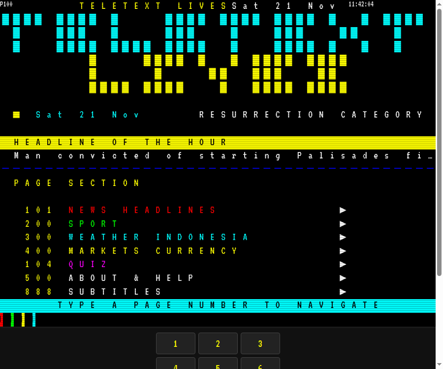
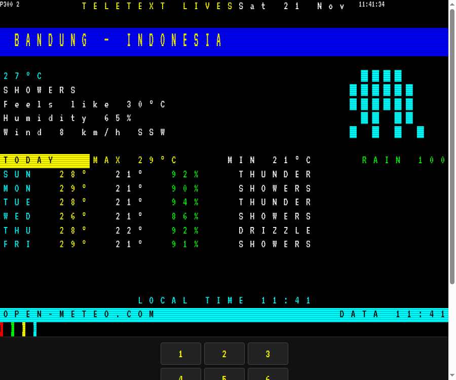
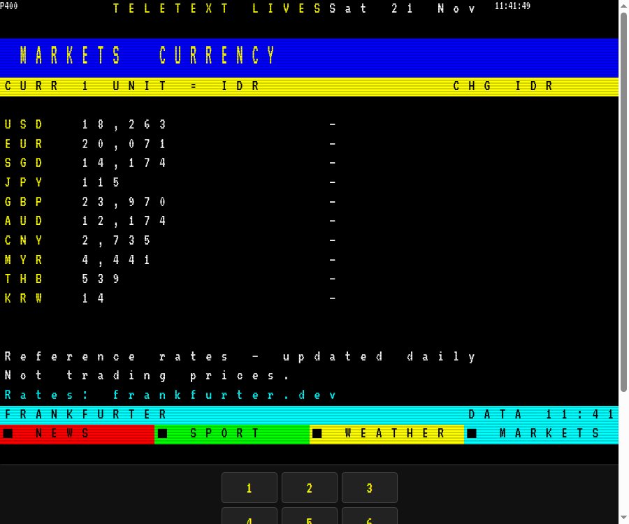

# TELETEXT LIVES

Between the 1970s and 2012, millions of people got their news, weather, football scores and flight times from teletext: chunky coloured text on page numbers you typed into a TV remote. Ceefax (BBC), ORF TELETEXT and their siblings were the web before the web — instant, free, brutally simple, and loved. **TELETEXT LIVES** resurrects that exact experience in a browser: you type a 3-digit page number to navigate a faithful 40-column × 24-row MODE-7 grid (black background, 8 colours, double-height headers, mosaic block graphics, a ticking header clock), but every page is powered by live 2026 data from free, keyless public sources. The weather page shows today's real Jakarta forecast, the news page shows this hour's real headlines, and the markets page shows today's real IDR exchange rates.

## Live demo

**<https://ninochaan.github.io/teletext-lives/>**

Deep links work. For example, <https://ninochaan.github.io/teletext-lives/#300> goes straight to the weather page.

## Screenshots


*Page 100 — index with the headline of the hour*


*Page 300 — live weather, Bandung*


*Page 400 — IDR currency table*

## Pages

| Page | Name | What it shows |
|------|------|---------------|
| 100 | Index | Logo, date, headline of the hour, master index |
| 101 | News headlines | Latest headlines, newest first |
| 102 | News story | One story per screen, with a link to the original |
| 104 | Quiz | 5 general-knowledge questions, answers hidden until REVEAL |
| 200 | Sport | Football headlines and latest scores |
| 201 | Football scores | Results and fixtures by league |
| 300 | Weather — Indonesia | Jakarta now plus a 7-day outlook, rotating Indonesian cities |
| 301 | Weather — world | Current weather in major world cities |
| 400 | Markets / currency | 1 unit → IDR reference rates |
| 500 | About & help | What teletext was, how to use the app, credits |
| 888 | Subtitles | A subtitled nature documentary that never quite happened |

**Navigation:** type 3 digits on a keyboard or the on-screen keypad, and the page changes on the third digit, as on a TV remote. You can also tap index entries. The fastext keys are R (red), G (green), Y (yellow) and C (cyan). HOLD freezes subpage rotation.

## How to run locally

There is no build step and there are no dependencies.

```sh
git clone https://github.com/ninochaan/teletext-lives.git
cd teletext-lives
python3 -m http.server 8000
```

Then open <http://localhost:8000>.

Opening `index.html` directly via `file://` will not work, because the live data fetches require http(s).

All data sources are free and keyless. An internet connection is needed for live data. Without one, pages fall back to cached data or clearly labelled samples.

## Data sources & credits

- **[Open-Meteo](https://open-meteo.com/)** — weather forecasts and geocoding. Licensed CC BY 4.0. *Weather data by Open-Meteo.com.* The free tier is for non-commercial use, which fits this non-commercial hackathon demo.
- **BBC News & Sport RSS** — headlines and short descriptions only, always linked to the original story on bbc.com. The feeds send no CORS headers, so they are fetched through public CORS proxies. The proxies see only the feed URL, and the app collects no user data.
- **The New York Times RSS** — runtime fallback for news when the BBC chain fails. It is labelled on screen when used.
- **[Frankfurter](https://frankfurter.dev/)** — currency reference rates, updated daily. These are not trading prices.
- **Exchange Rate API** via open.er-api.com — currency fallback. [Rates By Exchange Rate API](https://www.exchangerate-api.com).
- **ESPN scoreboard** — unofficial endpoint, used as an experimental enhancement only. **[OpenLigaDB](https://www.openligadb.de/)** — football fallback. When neither is available, bundled sample scores are shown, always labelled "SAMPLE DATA" on screen.

## Built with Kiro

Kiroween 2026 hackathon entry. Category: **Resurrection**.

Built spec-first with Kiro CLI. The [`/.kiro`](.kiro) folder in this repo holds the steering files and the `teletext-lives` spec (requirements, design, tasks) that drove the build task by task.

## Licence

MIT — see [LICENSE](LICENSE).

The one third-party asset loaded at runtime is the VT323 font (Google Fonts, SIL Open Font License).
